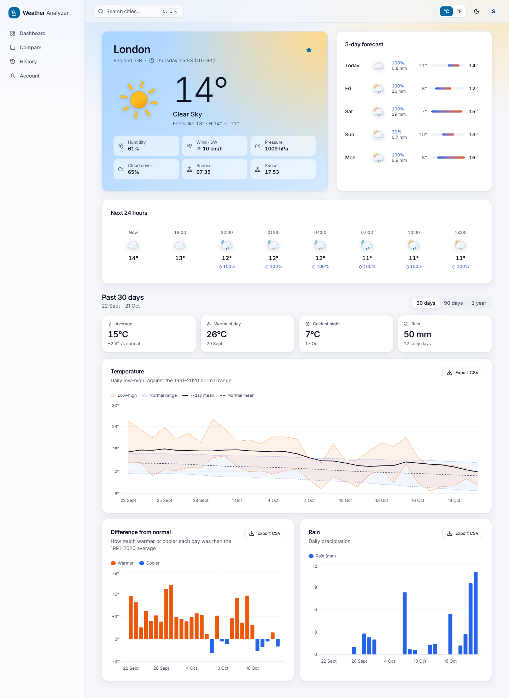
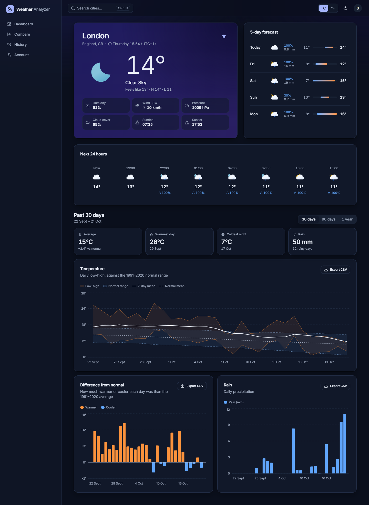
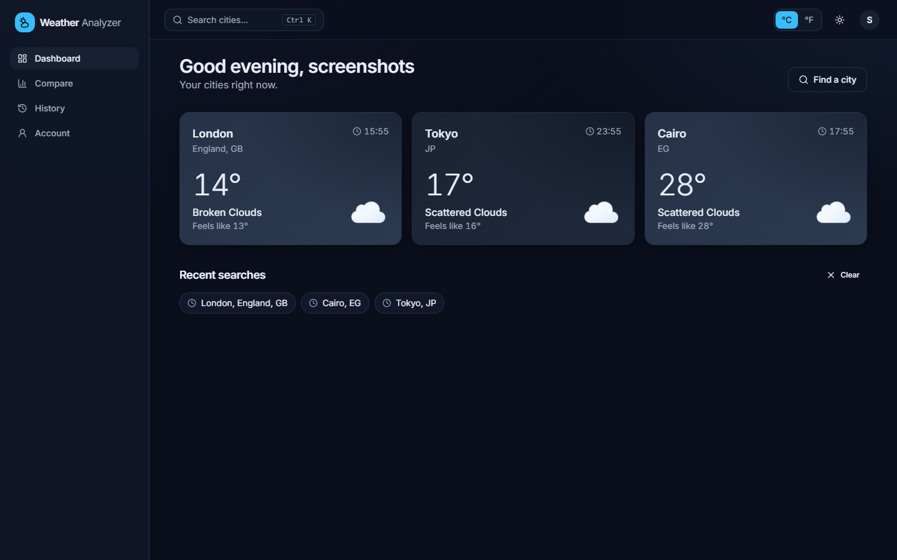
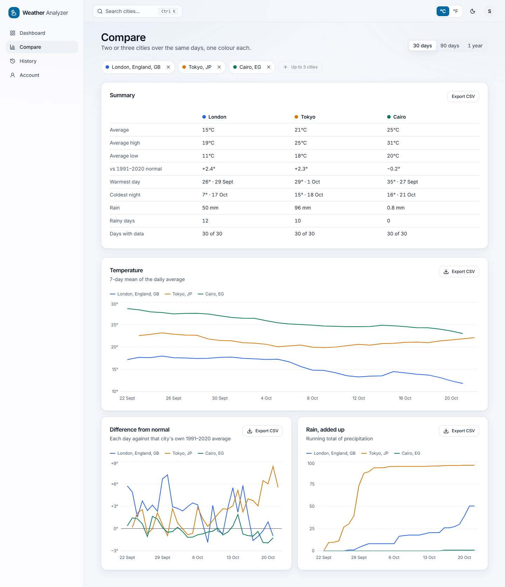
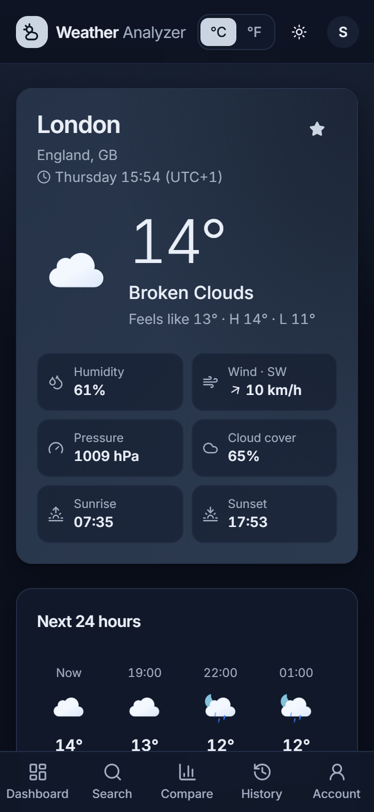
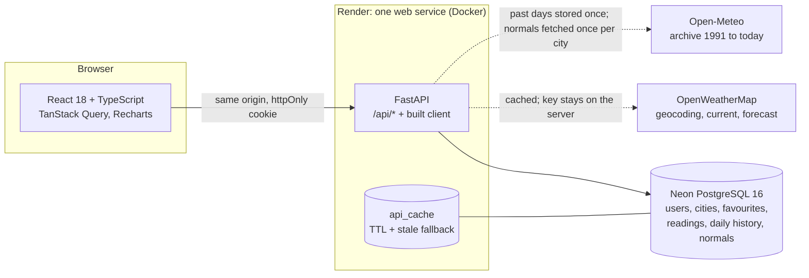

# Weather Data Analyzer

**Today's weather, and how unusual it is.** Search any city, see the current conditions and the
forecast, then compare the last 30, 90 or 365 days with the 1991–2020 climate normal, for one
city or up to three side by side.

A full-stack rebuild of an earlier Streamlit app: **FastAPI + PostgreSQL** on the server, **React +
TypeScript** in the browser, deployed as one service on Render with a Neon database.

| City page: clear day (light) | City page: clear night (dark) |
|---|---|
|  |  |

| Dashboard | Compare | Phone (375px) |
|---|---|---|
|  |  |  |

More screenshots of every page, at 375px and 1440px in both themes, are in [docs/screenshots/v2](docs/screenshots/v2).

## Features

- **City search** with autocomplete ("London, GB" vs "London, Ontario, CA") from a Ctrl+K command
  palette, the header, or the phone's bottom bar.
- **City page:** local time, current temperature, feels-like, humidity, wind with direction,
  pressure, cloud cover, sunrise/sunset, the next 24 hours and a 5-day forecast with range bars.
  The page's colours follow the city's weather and time of day (clear day, clear night, clouds,
  rain, storm, snow, mist).
- **History against the normal:** 30/90/365 days of daily low–high against the 1991–2020 normal
  range, a warm/cool anomaly chart, rain, the warmest/coldest days, and coverage warnings when days
  are missing. Every chart exports its data as CSV.
- **Compare** two or three cities over the same days, with one colour per city across every chart
  and the summary table.
- **Dashboard** of favourite cities, each card in its own city's weather colours, plus recent searches.
- **History** of every reading you've saved, filterable by city, paged, exportable.
- **Account:** °C/°F (saved on the account), light/dark, change password, log out.
- Works at 375px (bottom navigation) and on desktop (sidebar). Skeleton loaders, friendly empty
  and error states with retry, a "stale data" badge when the weather service is down, visible
  keyboard focus, and reduced motion support (the animated icons stand still).

## Architecture



- **One origin.** FastAPI serves the API and the built React app, so the session is a plain
  httpOnly cookie with no CORS anywhere.
- **Every call to an outside API goes through a database cache** (geocoding 7 days, current
  weather 10 minutes, forecast 1 hour). If OpenWeatherMap is down, the last answer is served with
  `stale: true` and the UI shows a badge.
- **History is stored, not refetched.** Open-Meteo days older than a week are final and kept for
  good; only the latest week is refreshed, at most every 6 hours. The 1991–2020 normals (365 rows
  per city) are computed once, the first time a city's history is opened.
- **The analysis is pure functions** (pandas): a DataFrame goes in, numbers come out, with
  explicit handling of missing days. They're unit-tested on small hand-made data.
- **Parallel where it helps:** the dashboard and compare load cities concurrently (at most 5 at a
  time), each worker with its own database session.

## Tech stack

| | |
|---|---|
| Backend | Python 3.12, FastAPI, SQLAlchemy 2, Alembic, Pydantic v2, httpx, pandas, bcrypt, PyJWT |
| Database | PostgreSQL 16 (Neon in production and development) |
| Frontend | React 18, TypeScript, Vite, Tailwind CSS v4, Radix UI (shadcn-style), cmdk, TanStack Query, Recharts, framer-motion, lucide-react, Meteocons |
| Tests | pytest + respx against a real Postgres; Vitest + Testing Library; Playwright screenshots |
| CI / deploy | GitHub Actions (postgres:16 service), Docker, Render Blueprint |

## Run it locally (Windows PowerShell)

You need Python 3.12, Node 22 and two empty PostgreSQL databases: one for development, one for
the tests (the tests wipe theirs). Two Neon branches work well. `docker compose up -d` also gives
you both locally (see `docker-compose.yml`).

```powershell
git clone https://github.com/Galvin70124O/weather-data-analyzer.git
cd weather-data-analyzer
copy .env.example .env        # fill in DATABASE_URL, TEST_DATABASE_URL, JWT_SECRET, OPENWEATHER_API_KEY

# backend (window 1)
python -m venv server\.venv
server\.venv\Scripts\activate
pip install -r server\requirements-dev.txt
cd server
alembic upgrade head
uvicorn app.main:app --reload            # http://127.0.0.1:8000/api/docs

# frontend (window 2)
cd client
npm.cmd install
npm.cmd run dev                          # http://localhost:5173 (proxies /api to :8000)
```

A free OpenWeatherMap key is enough; new keys can take an hour or two to activate. Generate
`JWT_SECRET` with `python -c "import secrets; print(secrets.token_urlsafe(48))"`.

## Tests

```powershell
cd server; pytest                         # 160+ tests on a real Postgres; outside APIs are mocked
cd server; alembic check                  # models and migrations match
cd client; npm.cmd test                   # Vitest: units, CSV, API client, pages, search flow,
                                          #   and WCAG AA contrast of every colour theme
cd client; npm.cmd run typecheck
cd client; npm.cmd run screenshots        # Playwright (installed Edge), needs both dev servers running
```

The pytest suite refuses to run if `TEST_DATABASE_URL` is missing or equals `DATABASE_URL`. CI
runs the same checks on every push and pull request ([.github/workflows/ci.yml](.github/workflows/ci.yml)).

## Deploy (Neon + Render)

1. **Neon:** create a project with a `production` branch and copy its connection string
   (`postgresql://...?sslmode=require`). Keep separate branches for development and tests.
2. **Render:** *New → Blueprint*, pick this repository. Render reads [render.yaml](render.yaml)
   and creates one Docker web service. It asks for:
   - `DATABASE_URL`: the Neon production string
   - `OPENWEATHER_API_KEY`: your key

   `JWT_SECRET` is generated by Render, and `ENVIRONMENT=production` is set for you.
3. The image builds the client, installs the server, then runs `alembic upgrade head` and
   `uvicorn` on every start. Render checks `/api/health`.

In production the session cookie is `Secure`, HSTS is on, and the app refuses to start with a
missing or short `JWT_SECRET`.

## Security notes

- **Secrets** live only in environment variables (`.env` locally, git-ignored). The
  OpenWeatherMap key is added to requests in one place on the server. It never reaches the
  browser and never appears in logs: httpx's log lines are redacted, and the tests check that.
- **Sessions:** a JWT in an httpOnly, SameSite=Lax cookie (Secure in production), never in
  localStorage. Changing your password signs out your other sessions.
- **Passwords:** bcrypt (cost 12). Failed logins are rate-limited per account and per IP in the
  database, so a restart doesn't reset the limit.
- **Cross-site requests:** besides SameSite, every state-changing `/api` request must be
  `application/json` (else 415), which plain HTML forms on other sites can't send. There is no CORS.
- **Data scoping:** every user-owned query filters on the logged-in user. A test fails if any
  new `/api` route answers without a login.
- **Browser hardening:** a strict Content-Security-Policy (the one inline script is allowed by its
  hash), `X-Frame-Options: DENY`, `nosniff`, and in-app-only login redirects. CSV exports
  neutralise spreadsheet formulas.

## Credits

- Weather, forecasts and geocoding: [OpenWeatherMap](https://openweathermap.org/).
- Historical weather and the 1991–2020 normals: [Open-Meteo](https://open-meteo.com/) Historical
  Weather API, data licensed under [CC BY 4.0](https://creativecommons.org/licenses/by/4.0/).
  Open-Meteo's free API is for non-commercial use.
- Weather icons: [Meteocons](https://github.com/basmilius/weather-icons) by Bas Milius (MIT).
- Font: [Inter](https://rsms.me/inter/) (SIL Open Font License).

The original Streamlit version is kept in [`legacy/`](legacy/). Conventions for working on the
code are in [CLAUDE.md](CLAUDE.md).
